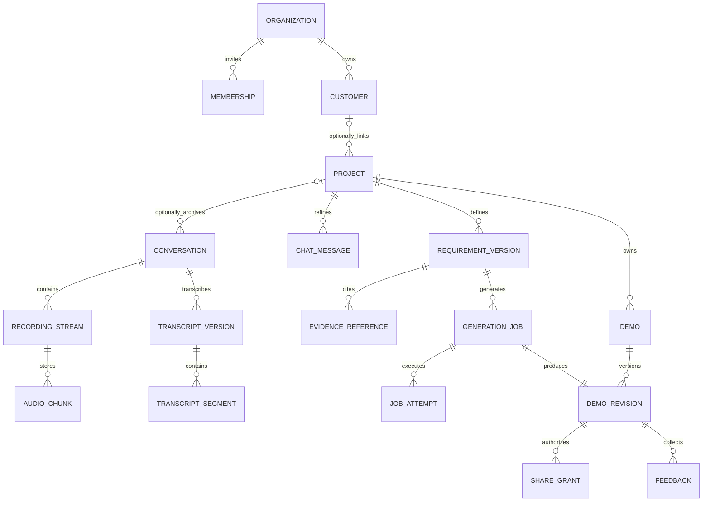

# 数据与 API 契约草案

状态：方案草案。日期：2026-10-12，Asia/Shanghai。本文件只有文字契约，没有代码、SQL、可执行 Schema 或已实现接口。
术语以[功能方案](../../01-%E5%95%86%E5%8A%A1%E4%B8%8E%E9%9C%80%E6%B1%82/%E5%AE%A2%E6%88%B7%E8%B5%84%E6%96%99/functional-spec.md)和[技术架构](technical-design.md)为准；路径与字段为未来设计基线，可评审调整。

## 1. 归属与关系

平台 PostgreSQL 存业务归属和证据，私有对象存储存大文件；每个 Demo 自己的 SQLite 保存合成业务数据，两类库没有共享数据库权限。

| 对象 | 关键字段及约束 | 所有权/保存位置 |
|---|---|---|
| organization / membership | tenant_id、user_id、role、status、invited_by；试点仅邀请账号。 | 平台 PG；角色变更有审计。 |
| customer | id、tenant_id、display_name、industry、必要联系信息；联系方式可空。 | 组织归属，按项目协作权限访问。 |
| project | id、customer_id 可空、owner_id、目标、stage、follow_up_at、version、deleted_at。 | 组织内销售负责，主管按监督范围；可先不关联客户。 |
| conversation | id、project_id 可空、tenant_id、owner_id、source_type、title、status、consent_record、incomplete、来源元数据。 | 未归档会话由本人访问，关联项目后继承项目权限，不进入 preview。 |
| recording_stream | id、conversation_id、order、mime、codec、start_event_at、end_event_at、status。 | 原始字节逐流保存；重开 Recorder 新 ID。 |
| audio_chunk | stream_id、seq、sha256、bytes、object_ref、acked_at；stream+seq 唯一。 | 受控对象 + PG 元数据。 |
| audio_asset | id、manifest_hash、duration_ms、encoding、time_map、audio_available、expires_at。 | 原音/标准音频私有存储；源上传总量 100 MiB。 |
| analysis_task | id、purpose、source_version、status、attempt_count、provider_task_id、usage、error_code。 | 业务 task_id 为主键，厂商 ID 为外部引用。 |
| transcript_version / segment | version、parent_version、edited_by、segment_id、text、start/end_ms、speaker_id、role_mapping。 | PG 文本 + 受控原始结果对象；版本不可变。 |
| chat_message | id、project_id、conversation_id 可空、author_type、content、source_kind、created_at。 | author_type 与 customer_quote/sales_note/ai_suggestion/customer_feedback 来源类型分开。 |
| requirement_version | requirement_id、version（业务版）、edit_revision/ETag（draft 编辑序号）、schema_version、status、内容、evidence、canonical_hash、confirmed_by/at。 | PG；draft 编辑推进 edit_revision，确认后业务 version/hash 不可改，来源固定。 |
| template_version | template_id、version、hash、lock_hash、image_digest、entity/screen/workflow limits、license_manifest。 | 平台策划全局目录，源码产物受控。 |
| generation_job | id、tenant_id、request_id、demo_id/revision、spec_version/hash、demo_scope/hash、template_version/hash、policy_version、allowed_provider_model_policy、status、active_attempt、cancel_requested_at。 | PG durable 状态；同请求幂等；同一 demo 的 revision 分配原子化。 |
| job_attempt | id、job_id、attempt_no、reason、stage、repair_round、实际 provider/model/API/mode/capability_version、lease_until、fencing_token、heartbeat、usage、failure。 | 每次执行不可覆盖，自动修复属于该 attempt；实际型号不得超冻结允许策略。 |
| demo | id、project_id、tenant_id、owner_id、title、current_revision、created_at、deleted_at。 | 平台 PG 的父对象，关联各演示版本与列表。 |
| demo_revision | id、demo_id、revision、job_id、artifact_hash、validation_ref、runtime_state、snapshot_ref、expires_at。 | PG 登记，源码/快照对象存储；成功 gate 后才可访问。 |
| share_grant | id、demo_revision、audience、scope、token_digest、expires_at、revoked_at、created_by。 | 客户仅 demo-only，明文 token 不入普通日志。 |
| gallery_case | id、tenant_id 可空、visibility、sanitized_schema/seed_ref、publish_review、owner。 | 平台合成模板全局；客户派生案例默认租户私有。 |
| feedback | id、revision、share_id 可空、author_type、text、created_at、processed_requirement_version。 | 有范围的客户反馈，不改变现有运行输入。 |
| outbox / idempotency / audit | event_id、operation_key、payload_ref、lease/fencing、actor、action、版本/hash、created_at。 | PG；审计最小化内容、访问另授权。 |

模型不得赋值 tenant_id、owner_id、confirmed_by 或授权字段；API 从身份和已授权父对象导出。关系查询先按 tenant/授权过滤，避免返回他租户存在性。

## 2. 状态契约

| 对象 | 合法状态 | 主要语义 |
|---|---|---|
| conversation | draft / recording / uploading / verifying / ready / incomplete / failed / deleted | ready 表示输入已持久化并可分析；incomplete 需明确接受及缺失提示。 |
| recording_stream | recording / uploading / finalized / incomplete / failed | 只有完整确认片序列才能 finalized。 |
| analysis_task | queued / transcribing / analyzing / ready / failed / cancelled / timed_out | ASR 用 transcribing，需求用 analyzing；不可把 ready 当需求确认。 |
| requirement_version | draft / confirmed / superseded | 新版确认后旧版 superseded；仍允许旧 job 引用。 |
| generation_job | queued / planning / generating / validating / repairing / starting / succeeded / failed / cancelled / timed_out | status 显示 active 或最新 attempt；历史 attempt 不改。 |
| job_attempt | 同 generation_job | terminal 后不可复活；人工 retry 新建 attempt，再令 job queued。 |
| runtime | provisioning / running / sleeping / waking / expired / failed / deleted | 当前运行状态，不覆盖历史 job succeeded。 |
| share_grant | active / expired / revoked | runtime 唤醒不延长 expires_at。 |

正常生成转换：queued → planning → generating → validating → starting → succeeded；validating → repairing → validating 最多 2 轮。任意活动状态可到 failed、timed_out 或停止确认后的 cancelled。
cancel_requested_at 是独立请求标志；queued 无执行资源时可立即取消，其余须停止模型/进程并完成清理确认。succeeded 后取消生成没有意义，应停止/删除 runtime 或撤销 share。
failed/timed_out 的人工 retry 保持原 job 输入不变，新 attempt 排队；cancelled 默认要求用户明确 retry，不能自动恢复取消任务。

## 3. 证据、冻结和一致性

evidence reference 记录 source_type（音频转写/文本/消息）、source_kind（customer_quote / sales_note / ai_suggestion / customer_feedback）、source_id、transcript_version/message_id、原文摘录、start/end_ms（有音频才填）、speaker role；epistemic_status 为 fact / inference / unknown，confirmation 为 pending / accepted / edited / rejected，三者独立。
访谈引用需检验片段与原文，不允许模型伪造 ID；sales_note 的来源就是销售消息，不冒充客户发言。音频已到期时记录 audio_available=false；全文到期后只保留 confirmed spec 必要摘录，明确 source_fulltext_available=false。
确认请求必须携带 expected_version/ETag、确认范围及已接受假设；身份来自 session。规范化内容的 hash 由服务器计算，不信任客户端上报 hash。
confirmed spec、selected demo_scope、template_version 和 policy_version 一同固定到 job；改聊天或需求不修改运行中的输入。job 冻结允许的 provider/model 策略，attempt 保存具体执行型号/API/mode 和 capability_version；手动 retry 只能在已冻结允许策略内选已验证模型，登记原因，不绕过工具、时限或预算。需要扩大允许策略则新建 job。
15 分钟上限按 attempt 从首次 lease acquisition 起计，不包含排队，恢复不重置该 attempt 截止；人工 retry 为新 attempt，job 与租户累计费用/调用预算继续生效。
项目删除立即拒绝新处理、撤销 share 和来源访问，生成任务转取消流程；对象删除异步记录进度，备份按隔离滚动 30 天政策到期物理清理，恢复时先重放删除清单。

## 4. 通用 HTTP 约定

基路径拟为 /api/v1。业务平台接口要求登录；邀请接受和登录验证入口用邀请/短期验证凭据，公开模板目录不要求既有 session 且只返回平台策划的脱敏内容。客户预览/反馈使用独立 audience，不能调用平台接口。
写操作采用 CSRF 防护（若 cookie session）、请求 ID、服务端 tenant/ownership 校验和审计。读取分页使用稳定 cursor，列表不以客户端 tenant_id 确定授权。
POST 创建/长任务带 Idempotency-Key；键按 tenant + actor + operation 作用域，保存请求摘要和结果引用。相同键/内容返回原结果，不同内容返回 409 idempotency_conflict；保留窗口建议覆盖业务重试周期，具体时长需配置。
更新/确认带 If-Match 或 expected_version，过期返回 409 version_conflict 与授权范围内的最新版本。删除幂等，重复删除返回同一删除任务/结果。
响应包含业务 id、status、version/hash 适用字段、request_id；错误包含 code、可读 message、retryable 和 trace_id，不返回原始凭证/堆栈/他租户信息。
常用 HTTP 状态：200 查询/幂等结果，201 新对象，202 异步受理，204 无内容，400 格式错误，401 未登录，403 本人对象权限不足，404 不存在或需隐藏的越权对象，409 冲突，413 超大小，422 业务校验，429 配额/限流，503 服务不可用。

## 5. MVP 平台 API 文字契约

表中 L 为登录用户，S 为项目授权销售/主管（会话未归档时包含直接 owner 对该会话及其流、音频、转写、分析等下属资源的权限），A 为组织管理员，C 为客户 demo-only bearer，P 为公开合成模板。所有输入隐含服务端归属校验。

| 方法与路径 | 权限、输入 | 结果、状态与特殊错误 | 幂等/并发 |
|---|---|---|---|
| POST /auth/invitations/{token}/accept | 持有效邀请者；邀请绑定身份的验证凭据、接受动作。 | 200 已验证 membership/session 或下一验证步骤；410 到期，409 已被其他身份消费。 | 邀请原子单次消费，重复同身份返回已完成结果。 |
| POST /auth/login/start | 未登录；邀请过的账号标识。 | 202 验证流程受理，不泄露账号存在性；429 限流。 | 请求键，身份 PoC 决定验证渠道。 |
| POST /auth/login/complete | 未登录；短期验证凭据。 | 200 host-only session；401 无效凭据，410 到期，403 非活跃邀请成员。 | 凭据原子消费，session rotation。 |
| GET /auth/session；POST /auth/logout | L；session 查询/注销。 | 200 当前身份/204 注销并服务端失效；401 过期。 | 注销幂等；认证方案尚未实现。 |
| GET /me；GET /organizations/current | L；无 tenant 自选参数。 | 200 身份、当前组织、角色、配额；401 未登录。 | 只读。 |
| POST /organizations/current/invitations | A；邮箱/角色。 | 201 邀请记录；422 非法角色，429 配额。 | 创建键。 |
| PATCH /organizations/current/members/{id} | A；新角色/status、expected_version。 | 200 成员；409 旧版，422 最后管理员不可移除。 | 版本检查。 |
| GET /dashboard | L；时间范围、本人/授权组织范围。 | 200 明确口径指标、recent、待办；空值用真实 0。 | 只读。 |
| GET /customers；POST /customers | S；分页/搜索；创建称呼/行业/可选联系信息。 | 200 列表/201 客户；422 必要名称无效。 | 创建键。 |
| PATCH /customers/{id} | S；字段、expected_version。 | 200 客户；409 冲突。 | 版本检查。 |
| GET /projects；POST /projects | S；分页/搜索；customer_id 可空、目标、名称。 | 200 列表/201 项目，owner 由服务端设定。 | 创建键。 |
| GET /projects/{id}；PATCH /projects/{id} | S；更新名称、目标、stage、follow_up_at、expected_version。 | 200 项目及授权关联；409 旧版。 | 更新版本检查。 |
| DELETE /projects/{id} | 项目 owner/授权 A；确认删除范围。 | 202 deletion_task_id，立即逻辑失效；后续可查进度。 | 删除键。 |
| GET /deletions/{id} | owner/授权 A。 | 200 逻辑撤销/对象清理/备份窗口进度。 | 只读。 |
| POST /projects/{id}/conversations | S；source_type、title、consent_record/source_note。 | 201 draft conversation；422 缺少业务来源说明。 | 创建键。 |
| POST /conversations；PATCH /conversations/{id}/project | L/会话 owner；未归档来源，或关联授权 project_id、expected_version。 | 201 未归档会话/200 关联；tenant/owner 从身份确定，403 无项目权限，409 旧版，不允许跨 tenant。 | 创建键/版本检查。 |
| GET /conversations/{id} | S。 | 200 状态、流清单、音频可用、analysis 状态。 | 只读。 |
| POST /conversations/{id}/recording-streams | S；mime、codec、order、client_start_at。 | 201 stream_id 与允许上传范围；422 格式不支持。 | 创建键。 |
| PUT /recording-streams/{id}/chunks/{seq} | S 或任务限定上传授权；原始 bytes、hash、mime、事件时间。 | 201 ACK/200 同片 ACK；409 hash 冲突，413 超限。 | stream+seq+hash。 |
| GET /recording-streams/{id}/chunks | S；分页/缺片查询。 | 200 已 ACK 的 seq/hash/bytes；不直接公开存储 URL。 | 只读。 |
| POST /conversations/{id}/finalize | S；各 stream 的 expected_seq/hash/bytes 清单、最终事件确认、incomplete 接受。 | 202 verifying task；409 缺片/冲突，422 不完整未接受。 | manifest hash + 创建键。 |
| POST /conversations/{id}/file-upload | S；文件元数据/大小/hash，随后按返回上传约定传件并 finalize。 | 201 限定对象/分片授权；413 超 100 MiB，422 类型。 | 文件 hash 与创建键，不跳过校验。 |
| POST /conversations/{id}/text-sources | S；文本、来源说明、角色标注。 | 201 text source / ready；无音频时间戳。 | 创建键。 |
| POST /conversations/{id}/transcriptions | S；可用 audio_asset、引擎策略/重试原因。 | 202 analysis_task_id；409 输入未 ready，429 预算。 | task 输入版本+创建键。 |
| GET /analysis-tasks/{id} | S。 | 200 阶段、结果版本、usage、错误；ready 不等于确认。 | 只读。 |
| POST /analysis-tasks/{id}/cancel | S；停止原因。 | 202 取消请求；终态 200 原状态。 | 幂等请求。 |
| GET /conversations/{id}/transcripts | S；version 可选。 | 200 版本/segments/匿名角色/原音可用提示。 | 只读。 |
| POST /conversations/{id}/transcript-versions | S；parent_version、片段纠正、角色映射。 | 201 新版；409 旧基线，422 来源不存在。 | 创建键+parent 校验。 |
| GET /projects/{id}/messages；POST /projects/{id}/messages | S；分页；文本、source_kind、引用来源。 | GET 200 消息；POST 201 已保存 message 与 queued reply_task_id；422 标签/来源无效。 | 用户消息键；AI 回复任务去重。 |
| POST /projects/{id}/requirement-analyses | S；固定 transcript/message 版本、用途。 | 202 analysis_task_id；422 来源不存在/过大，429 配额。 | 输入 hash+创建键。 |
| GET /projects/{id}/requirements；GET /requirements/{id}/versions/{v} | S。 | 200 draft/confirmed/superseded 及 evidence，来源可用标记。 | 只读。 |
| PATCH /requirements/{id}/versions/{v} | S；仅 draft、修改项/接受状态、expected_edit_revision/If-Match。 | 200 同业务 v 的新 edit_revision/ETag；409 冻结/旧编辑序号，422 关系错误。 | draft 编辑序号检查。 |
| POST /requirements/{id}/versions/{v}/confirm | S；expected_edit_revision/If-Match、明确接受假设/范围。 | 200 confirmed、固定业务 v/服务器 hash/人/时间；422 critical ambiguity。 | 确认键+draft 编辑序号检查。 |
| POST /requirements/{id}/versions | S；parent_version、变更来源/反馈。 | 201 新 draft，不改原 confirmed。 | 创建键。 |
| GET /templates；GET /templates/{id}/versions/{v} | P/L；分类/分页。 | 200 平台合成目录、范围、许可/固定版本摘要；不带凭证。 | 只读。 |
| GET /gallery/cases | L；本组织筛选。 | 200 tenant-private 案例和全局已审脱敏案例。 | 只读，授权过滤。 |
| POST /gallery/cases/{id}/reuse | S；目标项目、允许 schema/seed。 | 201 新脱敏范围草稿；不复制来源音频。 | 创建键。 |
| POST /gallery/cases/{id}/publish；POST /gallery/cases/{id}/unpublish | owner/授权 A；脱敏检查、预期版本。 | 200 发布/撤销；422 未脱敏，403 开关未开放。 | 创建键+版本。 |
| POST /generation-jobs | S；confirmed requirement_version/hash、template_version、demo_scope、request_id、可选 demo_id/expected_current_revision。 | 202 job_id/demo_id/revision；首次原子创建 Demo 父对象，续作仅同项目 Demo 原子新增 revision；409 旧 hash/当前 revision 冲突，422 超范围，429 配额。 | tenant+request_id；同键同输入返回原 job；revision 分配并发检查。 |
| GET /generation-jobs；GET /generation-jobs/{id} | S；分页/过滤。 | 200 状态、active/latest attempt、范围/hash、阶段证据摘要。 | 只读。 |
| POST /generation-jobs/{id}/cancel | S；原因。 | 202 cancel_requested_at；终态 200 原状态。 | 幂等，清理后才 cancelled。 |
| POST /generation-jobs/{id}/retry | S；原输入不变、reason、冻结允许策略内的 provider/model 可选。 | 202 新 attempt、job queued；409 活动/已成功，422 不在冻结允许策略，429 预算。 | retry 请求键，明确追加费用；记录实际 capability_version。 |
| GET /generation-jobs/{id}/events | S；Last-Event-ID/after_event_id。 | SSE 安全进度事件；不能返回思维链/机密工具输出。 | 按持久 event_id 恢复。 |
| GET /demos/{id}/revisions/{r} | S。 | 200 产物/检查摘要/runtime/来源版本/过期时间。 | 只读。 |
| POST /demos/{id}/revisions/{r}/wake | S；可恢复 revision。 | 202 waking/200 running；410 expired，503 无容量。 | revision 唤醒幂等。 |
| POST /demos/{id}/revisions/{r}/reset | owner/授权 S；确认重置 seed。 | 202 快照/重置任务；409 当前写入或无有效 seed。 | 操作键，记录数据丢弃范围。 |
| POST /demos/{id}/revisions/{r}/exports | S；脱敏源码导出。 | 202 导出 task；410 产物过期，422 secret 检查失败。 | 操作键；下载短期授权。 |
| DELETE /demos/{id}/revisions/{r} | owner/授权 A。 | 202 撤销分享、删除 runtime/产物任务。 | 删除键。 |
| POST /demos/{id}/revisions/{r}/shares | S；scope、期望 expires_at（建议 7 天，实际不超过政策/产物剩余寿命）。 | 201 首次展示 bearer、share_id 与实际到期；同键重试 200 原 share_id，链接丢失可撤销重建；422 超政策/未成功。 | 创建键，不重复新建授权，明文 token 不入普通日志。 |
| GET /demos/{id}/revisions/{r}/shares；DELETE /shares/{id} | S。 | 200 状态/204 立即撤销；物理缓存清理异步。 | 撤销幂等。 |
| GET /usage；GET /settings | L/A；本人/授权组织范围。 | 200 usage 及可见策略，未知用量显式标记。 | 只读。 |
| PATCH /settings | A；允许政策、expected_version。 | 200 新 policy_version；422 地域/保留冲突。 | 版本检查，仅未来 job 生效。 |

## 6. 上传 finalize 与任务启动的顺序

client stop → final dataavailable → stop event → 每片 PUT 完成 ACK → 缺片查询补传 → finalize manifest → verifying → 服务端整流解码/标准化 → audio ready → 创建 ASR task。
finalize 受理不表示已经转写；缺片返回 409 missing_chunks 及允许归属内的缺片序号，补齐后同 manifest 重试。hash/size 冲突需核对原件，不静默改 manifest。
文件上传返回受限对象引用；上传完成只进入 verifying，校验通过才 ready。预签名上传凭证期限和最大对象大小由服务器限制，客户端不能自行命名 tenant 路径。
ASR 原件/结果写入采用任务与来源版本幂等键；供应商 submit 成功但响应丢失需对账/查询已记录 request，而非无限重提。

## 7. SSE、轮询与客户预览入口

进度事件持久字段为 event_id、job_id、attempt_id、stage、occurred_at、safe_summary、checks_summary、status_version。SSE 是通知，不是最终事实；GET job 返回当前事实。
客户端记录 Last-Event-ID，重连从其后事件恢复；重复事件按 event_id 去重。事件窗口过期时返回 resync_required，客户端 GET job + 当前 snapshot，不凭空补进度。
网络/浏览器代理不支持 SSE 时退化为有退避的 GET job 轮询；页面可见时建议 3–10 秒范围，终态停止，后台减少频率。该频率是策略而非时延承诺。
单独 customer 预览域提供 bearer exchange → demo-only cookie → 指定业务 origin；端口由服务器登记，不能通过用户 URL 参数任意代理内网。
客户 GET 预览需 share active、revision 未过期及 runtime 健康；sleeping 可返回 waking 过渡页，expired/revoked 返回统一不可用提示。runtime 唤醒不延长授权。
客户 POST /share-feedback（预览网关契约）输入当前 share/revision 的文本反馈、请求键，返回 201 feedback_id；限制长度/频率、清洗输出，拒绝过期授权。它不接收 tenant_id、工具命令或直接改需求。
preview 内 /api 为生成 FastAPI 的业务 API，不是平台 /api/v1。只有已登记业务功能可调用；分享者没有 platform admin 或 sandbox toolbox 权限。
MVP 同一 revision 的所有授权访客和销售共用一组合成 SQLite 数据，提示共享写入；reset 只允许 owner/授权销售且记录审计。分享 token 隔离访问权限，不声明为每访客提供数据副本。

## 8. 需在 PoC 固定的契约

技术负责人需验证上传授权、浏览器大 Blob、SSE 代理和 idempotency 保留窗口；数据责任人确认证据摘录/全文/音频/备份政策；安全负责人验证两种 audience、跨租户与窄端口分享。
接口字段评审后记录契约版本。未经 provider、模板、队列与隔离证据，不把文字 API 当作已具备运行能力。
