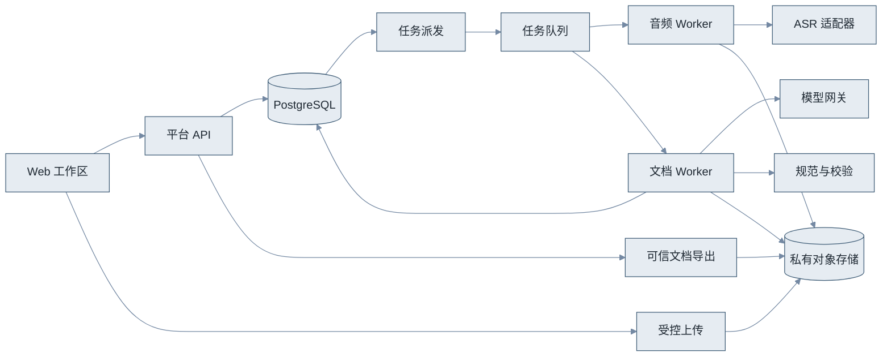

# Web 会议售前 Agent 平台开发文档

> 历史设计说明（2026-10-15）：本文保留 2026-10-14 V1 原文供追溯；当前首页实时转写、纪要PDF必需、产品库和四页导航，以及录音容量/恢复协议已由[实时平台设计 V2](realtime-platform-design.md)与[UI 规范](ui-spec.md)替代。冲突时以V2及最新[输出规范](agent-output-standard.md)为准，不按本文旧约束实施。

版本：V1.0（技术设计稿）  
日期：2026 年 10 月 14 日，Asia/Shanghai  
状态：仅开发设计；未创建应用代码、安装项目依赖或调用真实 ASR/模型。  
业务基线：[功能文档](functional-spec.md)；生成约束：[Agent 输出规范](agent-output-standard.md)。

## 一、设计目标与推荐路径

建议建设一个响应式 Web 平台：浏览器采集会议音频，服务端异步转写与处理，受控 Agent 从项目资料和会议证据中起草四类文档，平台负责版本、权限、规则校验、确认和 Markdown 交付。

下表比较三条可选路线。

| 路线 | 技术构成 | 优点 | 代价与适用 |
|---|---|---|---|
| A：会后处理，推荐 | 前台录音/上传 + 云文件 ASR + 固定 Agent 工作流 + Markdown | 首先验证完整录音和售前文档价值，失败可重试，保留来源较容易。 | 等待会后转写；需验证供应商地域、协议和实际质量。 |
| B：实时辅助 | 流式音频 + 实时 ASR + 在线字幕/增量摘要 + 会后定稿 | 会议中可看字幕和提示。 | 音频协议、网络、字幕修正和成本更复杂；仍需录后统一版本与定稿。 |
| C：全私有化 | 本地音频存储 + 自托管 ASR/LLM + 同一文档工作流 | 数据处理环境更可控，可满足严格内网需求。 | 模型许可、GPU、吞吐、运维与效果须单独验证；不能仅按代码许可证决定可商用。 |

首版采用 A，ASR 和模型通过适配器接入，保留切到 C 的路径。部署在甲方本地但调用云 ASR/LLM 时仍有资料发送到云端，不能描述成“数据完全不出内网”。B 必须另做实时音频 PoC，不将 MediaRecorder 容器片段直接当流式 PCM 帧。

已有 2026-10-12 技术调研可作为选型线索，见[录音与 ASR 笔记](<audio-and-asr.md>)及[旧技术架构](technical-design.md)。本轮未重新核验厂商实时文档、价格和可用型号，开发前按实际账号重核。

## 二、推荐技术栈

下表列出推荐组件与选择理由，不意味着已完成集成。

| 层 | 建议 | 职责及选型前提 |
|---|---|---|
| Web 前端 | React + TypeScript + Vite + Ant Design，辅以移动响应式布局 | 项目、录音、转写、Markdown 编辑与预览；团队熟悉 Vue 时可整体替换为 Vue，不同时维护两套平台。 |
| 录音与缓存 | getUserMedia + MediaRecorder + IndexedDB | HTTPS 前台采集、分片待上传缓存和恢复；能力和 MIME 必须实测探测。 |
| Markdown | CodeMirror 6 + react-markdown / remark-gfm | 支持 GFM 表格的受限预览与文本编辑，禁用原始 HTML/脚本；依赖版本和许可待开发固定。 |
| API | FastAPI + Pydantic + SQLAlchemy/Alembic | 权限、数据模型、结构校验、迁移、文档版本和导出。 |
| 业务数据库 | PostgreSQL | 项目、来源、任务、底稿、确认、规范、事件和审计的事实来源。 |
| 大文件 | 私有 S3 兼容对象存储 | 分片、音频、原始 ASR 结果、项目资料和文档；签名下载限对象、时间和身份。 |
| 队列 | Celery + 经验证的 Redis 协议 broker | 异步音频、提取、生成和导出；自托管可评估 Valkey，兼容性先测。 |
| 音频处理 | FFmpeg/ffprobe 受限 worker | 解码、转码、时长和音轨检测；无模型生成的任意 shell 命令。 |
| ASR | 境内文件 ASR 适配器 | 阿里、腾讯或火山候选用同语料比较，选一家主实现；FunASR/faster-whisper 是私有化候选。 |
| LLM | 模型网关 + 百炼/Qwen 或 DeepSeek 等经测试的模型 | 结构化提取、方案起草、证据核查；声明具体 API、模式、上下文和工具能力。 |
| Agent 编排 | 数据库持久化步骤 + 受限工具；可用 Agents SDK 做工具调用封装 | 编排持久状态由平台掌握，不依赖进程内聊天记录；SDK 不决定模型供应商。 |
| 进度 | SSE + 查询接口/轮询降级 | 显示任务阶段、问题及恢复进度，最终状态以数据库为准。 |
| 部署 | Linux 服务环境，反向代理/TLS，独立 API 和 worker | 本地 Windows 目录用于文档和开发；不建议生产 Celery worker 直接部署在 Windows。 |

首版不必上微服务集群、向量数据库或多 Agent 协作框架。项目资料量小可按显式选定版本直接提取；全量会议需求处理不能被相似度检索替代。

## 三、系统组件与数据流

下图说明数据流；它不授予模型访问所有存储的权限。颜色采用输出规范中的低饱和色板。

图中流程依次为：浏览器上传来源，平台登记任务，音频 worker 保存标准转写，文档 worker 生成结构化底稿和文档，规范检查与人工确认后由导出服务交付。无 Mermaid 支持时可直接依据此文字说明阅读。

下表明确组件边界。

| 组件 | 输入 | 输出 | 权限边界 |
|---|---|---|---|
| 平台 API | 登录请求、会议元数据、编辑/确认操作 | 业务对象、任务 ID、签名上传/下载授权 | 服务器计算 tenant/project 权限，不接受客户端自行扩大范围。 |
| 音频 worker | 验证过的任务、允许音频引用 | 标准音频、时长、时间映射、转写版本 | 解码进程资源受限，不访问无关项目。 |
| 文档 worker | 冻结来源集合、底稿、规范和模板版本 | 提取项、四份草稿、校验报告 | 只提供任务授权的读写工具，无终端、生产系统和任意网络工具。 |
| 模型网关 | 最小化材料、能力需求、预算 | 结构化响应及真实用量 | 持有模型密钥；Agent 不读取密钥。 |
| 规范/模板服务 | 管理员审核的版本 | 稳定章节、字段、色板、校验规则 | 业务材料不能改规范；模型只能消费，不能发布模板。 |
| 导出服务 | 已保存正文、版本、导出权限 | `.md` 或文档 ZIP、文件 hash | 模型不选择宿主路径；服务端清理文件名和内容。 |

## 四、录音可靠性与音频协议

### 4.1 音频来源标识

一个会议可有多个来源和录音流。每次创建新的 MediaRecorder 分配 `recording_stream_id`；暂停后继续同一实例沿用流，实例中断后重建使用新流。分片有 `seq`、SHA-256、字节数、实际 MIME、客户端采集时间及服务器接收记录。

浏览器先探测 MIME，再记录实际实例 MIME/codec；不以请求的采样率和声道数替代设备实际结果。分片的 `timeslice=5 秒` 是目标周期，事件延迟时 Blob 可更大，时长不能用分片数乘以 5 秒推算。

### 4.2 保存与停止顺序

完整保存顺序为：停止采集 → 等待最后 dataavailable 和 stop → 上传所有分片并确认 → 提交流 manifest → 服务端校验顺序/hash/大小/缺片 → 各流解码 → 形成标准音频 → 入队转写。

同一流按 seq 拼接原始容器片段，再解码；不能逐个 Blob 强行作为独立音频转码。不同流分别解码后按会议顺序组合，不能直接拼原始字节。原件和标准音频均登记；暂停和缺失区间有时间映射，ASR 时间是有效音频时间，UI 用映射回听定位，不能等同墙钟会议经过时间。

ACK 只有在分片对象持久保存且登记后返回；重复 `stream_id+seq` 同 hash 返回相同 ACK，不同 hash 返回 409。数据库与对象存储无共同事务，登记失败不返回成功，重试对账已有对象；孤立对象由清理任务回收。

服务端支持延迟产生的大 Blob。若超传输请求上限，用受控 multipart 上传一个逻辑媒体分片；传输小块和媒体 seq 分开计数，完整对象完成后才 ACK。不能为了请求上限将容器片段切成多个独立媒体流。

停止时用最终 manifest 确定期望分片，缺片 409 提供缺失序号；补传后重试。缺片但可解码的流仅在用户明确接受后标 `incomplete` 继续；最终内容注明来源缺损。解码失败保留原件并提供重新上传，不绕过校验调用 ASR。

### 4.3 容量与恢复配置

下表是首轮试点建议值，需要 PoC 后冻结为配置版本。

| 参数 | 建议及处理 |
|---|---|
| 单会议源音频时长 | 60 分钟；120 分钟仅容量探索。 |
| 源音频累计大小 | 100 MiB；转码副本单独计存储预算。 |
| 目标分片周期 | 5 秒；不作为真实事件或时长保证。 |
| 浏览器缓存 | 初稿上限 32 MiB 或可用配额允许量的较小者；同时监测可用空间，失败立即提示。 |
| 靠近限制 | 提前提示，达到限制正常 stop 并保存已有数据；前后台限制一致。 |
| 续录 | 查询服务器 ACK 清单，补传现有缓存；重建采集实例后新流，不假装尾片可恢复。 |

IndexedDB 是尽力缓存，可能被浏览器回收，不能承诺断网/退出无损。页面离开提示和 Screen Wake Lock（若支持）只作辅助，不能保证后台录音。

## 五、ASR、项目资料与证据标准化

### 5.1 ASR adapter

下表定义适配器文字契约。

| 方向 | 字段及规则 |
|---|---|
| 输入 | 受控音频引用/hash、语言、术语、是否请求匿名说话人、模型/地域、任务截止策略。 |
| 任务 | 保存 provider task/request ID；异步提交、查询、结果下载；完成结果及时持久化，避免依赖临时下载链接。 |
| 标准输出 | transcript_version、segment_id、start/end ms、speaker_id、原文、引擎/模型、原始结果引用、用量；有厂商置信度则保留其语义，不自造百分比。 |
| 校验 | 时间范围合法、来源音频匹配、片段顺序、覆盖范围；无语音、空结果、截断和缺段分别处理。 |
| 错误 | 鉴权/地域、格式、限流、超时、供应商失败、结果过期；错误分类决定是否重试。 |

人工纠错新增转写版本并记录 segment 对照和差异，旧引用仍指旧版本。说话人映射也版本化。转写分离效果待实测，无法区分保留未知，不将匿名聚类当身份识别。

### 5.2 项目资料读取

平台按用户授权上传/关联项目资料，不读取服务器任意磁盘路径。用户给定的本地参考文件在本轮只是设计来源；部署时需将经审核的规范和模板注册进平台，不能硬编码开发者的 `D:\Codes` 路径。

下表规定基础资料处理。

| 格式 | 处理与来源定位 |
|---|---|
| Markdown/文本 | 保留原件/hash，按标题和段落切分，记录字符/段落定位。 |
| 可抽取文字的 PDF | pypdf 等提取，保留页码；提取不能证明视觉结构，需要模板注册时人工核对。 |
| 扫描 PDF/图片 | 需要 OCR 能力与独立评测；基础版未配置时标记无法读取，不能假装已通读。 |
| Excel | 读取各工作表、有效区域、单元格值、公式及展示值；不执行宏/外链，定位 sheet+cell/range。 |
| Word | 作为后续资料适配器；未启用时提示转换成可读 PDF/文本。 |

通用规范要求通读项目全部资料，平台据此维护“本次输入材料清单”：每个指定资料有读取状态、覆盖范围及版本；必需文件解析失败进入资料缺口，不用检索少量片段替代已指定材料的完整处理。

资料文件格式、大小、压缩展开量、行列数及解析超时均有限制；worker 沙箱只处理文档解码，不执行上传内容。现有技术调研不是当前客户资料；行业公开数据不能当会议事实。

## 六、长会议提取与文档 Agent 工作流

### 6.1 固定、可恢复的步骤

下表定义文档任务步骤，每步保存输入版本/hash、输出、校验报告和状态。

| 步骤 | 处理 | 持久产物 |
|---|---|---|
| 1：冻结输入 | 选择本次会议/历史会议、补充资料、模板/规范，检查归属及读取状态。 | source_set_version、配置与模型策略。 |
| 2：全量提取 | 按片段边界切分，逐段提取事实、需求、否定、决定、行动项、数字、依赖和问题。 | 每段结构化抽取结果、覆盖记录和引用。 |
| 3：全局合并 | 程序去重 ID，模型辅助合并同义项；保留例外、冲突和时间变化。 | 结构化事实与需求底稿、冲突集。 |
| 4：范围判定 | 基于有效业务证据，默认单版；分期必须满足证据与确认条件。 | scope_mode、phase_evidence_ids、范围确认记录。 |
| 5：可行性与缺口 | 对每个需求核对技术路径、数据/设备/接口、失效条件和已核实产品能力。 | 需求清单、甲方配合事项、待核查结论。 |
| 6：文档起草 | 先纪要和清单，再按同一底稿生成总体框架/各层章节映射及方案；同类设备/AI 使用统一模板，缺信息明确显示。 | 四种结构化文档树、总体框架及章节映射。 |
| 7：质量校验 | 硬规则、证据和跨文档一致性，模型辅助检查语义支持。 | 错误/警告明细，受影响内容和建议修订。 |
| 8：有界修订 | 在预算内修订失败章节；未解决问题交用户。 | 修订草稿与实际用量，不能自报正式成功。 |
| 9：确认与导出 | 人工审核，平台复查，生成不可变文档包及导出。 | 确认记录、文档 hash、Markdown 及 ZIP。 |

自动化指任务可在会后持续处理，不代表自动批准方案或自动发送客户。基础版没有邮件、消息发送或生产系统写入工具。

ASR 结果持久化成功后，在同一业务事务中创建自动分析/文档 job 与 outbox；以会议来源版本和自动处理配置版本防重复触发。若用户选择先校对后生成，先提取讨论稿，方案由确认后的底稿另起 job；不能让一次供应商回调重复产生多套文档。

### 6.2 长会议避免遗漏

不能只把全文截到模型上下文上限，也不能仅根据相似度选几段后直接出完整需求。采用“全量分段提取 → 全局底稿 → 按章节起草”的分层处理。

分段按供应商实际 tokenizer/上下文预算计算，建议目标约 4,000 输入 token，仅为初稿；为指令、输出和工具返回留空间。以句/片段边界切分，可带相邻上下文，但每个 segment 有唯一主归属；程序依据主归属检查全量覆盖并按 ID 去重。

分段摘要之外保留完整结构化项及 source refs，特别保留“不能/不要/仅/必须”、数字、角色、规则、例外和后段决定。合并时不只合并自由文本摘要。候选需求同时记录已合并来源，不能因相似度删除不同条件。

正文每条事实与决定可回查底稿，语义检查用相关完整来源片段再次核对；ID 存在只是引用结构检查，不证明句子符合原意。人工评测长会议首、中、尾段和反转决定，衡量遗漏及修改耗时，不承诺零遗漏。

### 6.3 受限 Agent 工具

下表是拟议工具契约，不是本轮已实现接口。

| 工具职责 | 输入与输出 | 策略 |
|---|---|---|
| 读取选定会议/资料 | task_id、source_version、允许片段范围 → 来源内容与定位 | 必须在冻结来源集合内。 |
| 检索项目证据 | query、允许来源集 → 片段与定位 | 用于问答和核查，不能替代全量需求提取。 |
| 获取规范/模板 | 已冻结版本 → 章节、字段、规则、样式 | 只读，模型不能改规范或切换未经审核模板。 |
| 核对产品能力 | 已维护产品目录/技术核查记录 → 能力、证据、适用版本 | 缺证据返回待核实，不调用未知产品接口。 |
| 请求程序计算 | 允许指标类型、来源数值 → 结果与输入依据 | 固定计算器，不执行模型代码；不计算无来源输入。 |
| 保存草稿/提议修订 | 结构化文档及 expected_version → draft revision | 限当前任务/项目，不改变确认记录。 |
| 运行规则检查 | 文档包版本 → 硬规则和警告 | 校验器由平台维护，Agent 无权跳过。 |

SDK 若采用 OpenAI Agents SDK，显式配置实际模型 adapter，关闭默认外发 tracing，使用最小化内部审计。模型密钥在网关中；不把“兼容 OpenAI 接口”视为严格 Schema/工具/取消全兼容的证据。

每个模型能力组合需验证结构化输出、工具参数、上下文、截断、拒绝、usage 和错误。Pydantic 验证结构；未支持严格 Schema 时普通 JSON 解析并有界修正；格式正确不等于内容真实。

### 6.4 执行预算

建议试点每个文档生成 attempt 最多 24 次模型调用、每个失败节点最多 2 次纠正；LLM 工作流活动执行 deadline 初稿 20 分钟，排队和独立 ASR 等待不算在其中。原子记录剩余 token/费用预算，每次提取、修订、核查均计入；实际 token 和金额上限由样本评测及所购模型价格制定后才能开通。

这些上限是保护措施而非完成时间保证。分段数和起草预算预计超限时，先提示材料过长或拆分来源，不能截掉后半段。超预算保留已有结果，缺少文档的包标为未完成，不发布正式包。

## 七、规范作为服务端规则落地

将用户原规范拆成机器可校验配置和人工检查项，而不是只粘贴到 system prompt。

下表定义未来配置对象。

| 对象 | 必要字段 |
|---|---|
| output_policy | 版本、所有者、适用范围、单版默认、阶段证据要求、敏感信息政策、人工确认要求。 |
| proposal_template | 有序章节、适用条件、总体框架与各层对应章节、同类设备/AI 固定字段、图表种类、引导语规则、编号逻辑。 |
| requirement_template | 需求与实施验收字段、稳定 ID、来源/状态和覆盖规则。 |
| client_checklist_template | 12 列主表、权限关联表、填写模板、状态、回收与规则确认计算口径。 |
| style_profile | 低饱和色板、Web 预览样式、Word 的 A4/字体/边距/表格/图片参数。 |
| source_manifest | 三个参考文件原件 hash、解析摘要、适用映射、模板审核人和发布时间。 |
| model_capability_profile | provider/model/API/mode/region、结构及工具能力、测试版本、预算/限流。 |

`scope_mode=single_version` 是平台默认值；分期必须有该项目的有效证据与明确确认。单版检查方案正文、目录、文件名、模板标题、统计和图注，防止样板文字残留。来源摘录的原始分期文字允许在明确标注且与正文分离的引用中保存，不能靠简单删除“一期”两字掩盖实际分期。

规则检查分三层：程序检查字段、引用存在、章节顺序、分期、统计和凭证；模型辅助比较句子与证据、提取遗漏和隐性分期；人审核原意、可行性及甲方确认权限。模型检查不可替代人审，用户编辑后也重新执行受影响检查。

建立 `requirement_id → framework_layer_id → section_id → data_source_id / checklist_item_id / deliverable_id / acceptance_id / risk_id` 的关联图。每次增加或改动需求，程序列出应复核的总体框架、建设清单、数据来源、业务线、计划、交付、验收、配合、风险和能力说明；不适用关系需说明依据，不能靠关键词相同判定同步完成。模型根据关联图修订内容，平台重查结构和跨文档一致性，用户审核语义与遗漏。

公开搜索能力若后续启用，只从审核工具获取行业资料，记录来源/日期，标“外部依据”；客户资料不作为任意搜索请求外发。数字无依据就待确认，不能为补齐图表编数字。

## 八、数据模型与版本关系

下表给出核心数据对象，实际表结构在开发时通过迁移定义。

| 对象 | 关键字段与关系 |
|---|---|
| tenant / user / membership | 组织、登录身份、角色、状态；所有业务对象有 tenant_id。 |
| customer / project / project_member | 客户名称、项目目标、成员授权、负责人；客户名称与模板示例分开。 |
| meeting | project_id、主题、发生时间/时区、参与者、owner、来源完整性、知情记录。 |
| recording_stream / audio_chunk | stream、会议内顺序、seq/hash/bytes/MIME、ACK、manifest、缺失区间。 |
| source_asset / source_version | 音频/资料/笔记类型、对象 key/hash、解析状态、数据期间、版本、保留政策。 |
| transcript_version / segment / speaker_mapping | 不可变版本、稳定片段、音频时间、说话人、纠错及旧新对照。 |
| source_set_version | 本次全部输入版本/hash、读取覆盖、选择人；文档任务冻结它。 |
| evidence_ref | 来源版本、segment/页码/sheet+cell、必要摘录、定位可用状态。 |
| fact / decision / action / issue | 内容、来源、确认人及状态；决定与建议分别保存。 |
| requirement_version / requirement_item | REQ ID、角色、规则、依赖、实现/可行性、验收、优先级、来源与确认。 |
| project_brief_version | 事实/需求集合、范围模式、分期证据、冲突、核查版本、hash。 |
| checklist_item / checklist_revision / checklist_response | CL ID、12 列与关联权限信息、当前状态；文档使用不可变清单 revision；响应有作者、文件、确认。 |
| document / document_revision | 类型、结构化树、Markdown、source/brief/template/policy/checklist 版本、hash、draft 状态。 |
| document_bundle / approval | 绑定四份确切文档 revision、校验报告、发布/替代关系；平台审核与甲方认可分开。 |
| job / attempt / step_run | job 固定输入；attempt 执行次数；每步 checkpoint、lease、fencing token、预算、provider ID、错误。 |
| event / outbox / usage / audit / deletion_task | 进度通知、事务派发、实际用量、权限操作、清理进度和备份删除重放。 |

证据引用不可仅保存临时 URL；稳定 ID+版本+必要摘录支持离线定位。音频过期后标不可回听；资料全文到期后展示保留范围，不假装原件仍可下载。

生成任务冻结来源、项目底稿、清单 revision、规范/模板及模型策略；四类文档必须读取同一版本组合。用户在任务中改资料不改变当前 job，创建新底稿和新任务。部分重生成可以复用仍兼容的文档 revision，但新包必须验证全组版本兼容，不能只改封面版本号。

人工编辑使用 expected_version/ETag；过时请求 409。确认记录和正式 revision 不可变，修订新增版本；“客户已确认”需甲方明确回复及其来源，不能由平台发布操作自动填入。

## 九、API 文字契约

接口前缀拟定 `/api/v1`。以下是开发设计，不是可调用服务；所有资源包含组织/项目授权，客户端 tenant_id 不决定权限。创建和外部调用使用 Idempotency-Key，更新有 expected_version；同键不同 payload 返回冲突。

下表列出主接口。

| 方法与路径 | 用途 | 返回和关键限制 |
|---|---|---|
| GET /auth/session；POST /auth/logout | 登录会话查询/注销 | 身份从组织邀请或既有企业 OIDC 获取；host-only、HttpOnly、Secure cookie；状态变更防 CSRF。 |
| GET/POST /projects | 列表/创建项目 | 200/201；只显示被授权项目。 |
| GET/PATCH /projects/{id} | 项目查询/修订 | 200；版本冲突 409。 |
| POST /projects/{id}/meetings | 新会议 | 201；登记来源用途和知情记录。 |
| POST /meetings/{id}/recording-streams | 建立采集流 | 201 stream 与受控上传范围。 |
| PUT /recording-streams/{id}/chunks/{seq} | 逻辑分片上传 | 201/200 ACK；hash 冲突 409，超配置 413；大对象返回 multipart 约定。 |
| GET /recording-streams/{id}/chunks | 查询已保存/缺片 | 200；不公开存储桶访问权。 |
| POST /meetings/{id}/finalize | 流清单完整性提交 | 202 校验任务；缺片 409；不完整未接受 422；受理不等于转写已开始。 |
| POST /meetings/{id}/audio-uploads | 上传现有录音 | 返回受控上传任务；完成后仍须校验再 ASR。 |
| POST /meetings/{id}/notes | 粘贴记录/补充 | 201 来源版本；无音频时间戳。 |
| POST /projects/{id}/assets | 上传项目资料 | 201 资料及解析任务；必需资料解析失败可查询。 |
| GET /meetings/{id}/transcripts/{version} | 转写及来源 | 200；回听授权单独按音频可用性签发。 |
| POST /meetings/{id}/transcript-revisions | 纠错/映射说话人 | 201 新版本；保留旧版；409 并发冲突。 |
| POST /projects/{id}/analysis-jobs | 提取会议需求 | 202 job；固定来源集和规范版本。 |
| POST /projects/{id}/document-jobs | 生成四类或指定文档 | 202 job；要求同一底稿、范围、清单快照和预算。 |
| GET /jobs/{id}；GET /jobs/{id}/events | 状态和 SSE | 200；事件可重放，窗口过期要求重新查询快照。 |
| POST /jobs/{id}/cancel；POST /jobs/{id}/retry | 取消/新 attempt | 202；取消需停止证据；重试保留历史及可能追加计费。 |
| POST /projects/{id}/agent-messages | 基于来源问答/修订建议 | 返回受控会话或任务；改稿形成 draft，不自动发布。 |
| GET/PATCH /documents/{id}/drafts/{revision} | 编辑草稿 | 200；expected_version；编辑后复查。 |
| POST /document-bundles/{id}/confirm | 审核并发布 | 200 新确认记录；无权限 403，冲突 409，硬规则/缺文档 422。 |
| GET /projects/{id}/checklist；POST /checklist-items/{id}/responses | 资料跟进和回复 | 200/201；已提供不自动确认规则；建立清单新 revision。 |
| POST /document-bundles/{id}/exports | 单份 MD 或 ZIP | 202/200 导出；敏感内容失败禁止下载；签名授权短时有效。 |
| GET/POST /admin/output-policies | 规范版本 | 管理权限；发布前人工审核，旧 job 不自动迁移。 |
| DELETE /projects/{id}；GET /deletion-tasks/{id} | 删除及清理查询 | 202 即时失效并后台清理；进度可查。 |

统一错误包括 401 身份失效、403 无操作权限、404 资源不存在或需隐藏、409 版本/hash 冲突、413 体积超限、422 内容规则失败、429 配额/限流、503 依赖不可用。错误响应提供安全摘要、trace_id 和可重试标记，不泄露完整模型响应或凭证。

邀请制接入企业 OIDC 作为首选身份方案；没有身份服务时需在开发准备阶段确定本地邀请登录实现，不假设已有认证服务器。文档基础版不要求短信或外部会议账号。

## 十、任务状态、幂等与恢复

下表将业务对象和运行状态分离。

| 对象 | 状态与规则 |
|---|---|
| 音频 | recording/uploading、verifying、ready、incomplete、failed、deleted。停止按钮不直接进入 ready。 |
| 转写任务 | queued、running、succeeded、failed、cancelled、timed_out；succeeded 表示结果已自有持久化。 |
| 文档生成任务 | queued、extracting、merging、feasibility_checking、drafting、checking、succeeded、failed、cancelled、timed_out；允许跳过已校验 checkpoint。 |
| 文档 | draft、pending_confirmation、confirmed/published、superseded、deleted；任务 succeeded 仅表示指定草稿完成，不能自动变成 confirmed。 |
| attempt | 独立执行历史；人工 retry 新 attempt；原 job 输入不变，更换来源或规范新 job。 |

业务对象和 outbox 同事务写 PostgreSQL；派发器把 job ID/版本投到队列，重复投递由数据库防重。broker 非业务事实来源，不声称端到端 exactly-once。

worker 原子争取 lease 并获取单调 fencing token；每步输出及状态提交带 token，租约失效旧 worker 无法发布。崩溃恢复读取 checkpoint、外部请求状态和输出 hash，不因重投无条件再次收费调用。对象写入临时 key 后校验，再登记最终 revision；未登记产物不可下载，清理任务回收孤立对象。

ASR/模型请求发出但结果尚未落库时可能处于未知状态。记录调用意图、provider request/task ID 和尝试；能查询的先对账，无法查证的显示用量未知/待对账，再按明确重试策略处理。幂等不能保证供应商绝不重复计费。

取消先写 cancel_requested，禁止新步骤和工具调用，再协作式停止；音频处理进程超时强制终止。外部云任务若不能取消，平台不继续发布其结果并记录可能仍计费；只有本地执行及可控凭证清理后显示取消完成。

SSE 事件有持久 event_id、job/attempt、stage、status_version、时间、安全摘要。断线携 Last-Event-ID 恢复，窗口过期 GET 当前快照；轮询降级建议可见页 3–10 秒退避，终态停止。用户审批不占用 worker 和租约。

## 十一、文档渲染、导出与正式包

模型输出结构化文档树，服务端生成 Markdown，或将文本解析为树后校验。字段、标题和表格由可信渲染器统一输出，防止模型自由修改列名和章节顺序。

导出处理 `|`、换行、反斜线及代码围栏，保留中文、GFM 表格、来源定位、讨论稿/确认状态与版本。输入 HTML 默认作为文字或清洗，预览禁脚本、危险 URI 和未经许可远程资源；下载 `.md` 不夹带运行脚本。

文档包建议包含四份 Markdown、`文档索引.md` 和可读来源/版本索引；不默认含原音、原始客户资料或供应商完整响应。图像能力未启用时采用表格和文字，不输出断链图片占位；后续图片在 ZIP 内相对链接并附可读说明。

正文 hash 对规范化 UTF-8 内容计算，导出文件另有实际字节 hash。正式包在事务中绑定确切文档 revision 和审批，防止审核后正文变化。签名 URL 由 API 授权生成，不把临时对象地址写入离线正文。

Word/PDF/Excel 属后续导出适配器，严格消费相同文档树/结构化清单。Word 落实输出规范的全部参数并更新目录，用户审核后才出 PDF，逐页检查。Excel 若实现，保留必要下拉/筛选/模板关联和正确计算，禁继承财务样板业务数据及分期；没有这些实现不能在页面宣称可导出。

## 十二、安全、保留与运维

下表列出必要设计措施。

| 方面 | 措施 |
|---|---|
| 身份与范围 | 租户/项目授权贯穿 API、worker、模型工具、对象下载和索引；模板参考与客户材料隔离。 |
| 传输与存储 | TLS、私有对象桶、最小服务凭证、数据库备份；模型和 ASR 密钥服务端管理，不进入前端。 |
| 敏感信息 | 上传资料先标记并过滤账号口令、密钥等；工资/个人信息按必要范围使用；文档无明文凭证。 |
| 提示词注入 | 资料作为不可信内容与平台指令分离；固定工具名单/参数/来源范围，不允许运行命令或扩大授权。 |
| 日志 | 普通日志只存任务、阶段、用量、错误分类、耗时和 trace；原始模型结果若留存则独立受控且短期保留。 |
| 网络与供应商 | 按实际合同核实地域、训练使用、保留/删除能力和分包；云模型处理不伪装本地处理。 |
| 文件处理 | 限格式/大小/解压量，受限解码进程；不执行宏、外链、模型代码和任意网络请求。 |
| 删除 | 立即逻辑撤权、停止任务，再清原音/分片/转码/资料/转写/文档/索引和日志内容；备份到期清理及恢复后重放删除。 |

保留建议与功能文档一致：音频及副本 30 天、转写和未确认草稿 180 天、已确认稿及必要摘录随项目保存、备份窗口 30 天；实际政策版本由组织确认，删除请求可覆盖常规保留。供应商临时结果失效不等于供应商原音已删除。

基础内部试点可部署一个 API、独立音频/文档 worker、PostgreSQL、broker、对象存储及反向代理。CPU/内存/磁盘按 60 分钟录音和峰值并发测定，不能把参考 PDF 的“8 核/16G/1T”当本平台已验证规格。

建议每用户同时 1 个、每组织同时 2 个文档任务，属于初稿配额；音频处理与模型任务分队列，避免长任务阻塞 API。队列、数据库、对象存储、规范和确认记录均须备份；从备份恢复后验证文档 hash、授权和删除记录。

监控队列等待、lease 超时、解码/转写失败、结果过期、文档校验失败、重试用量、来源覆盖、对象清理及供应商额度。技术日志不暴露客户会议正文；告警指向具体故障和 trace，不显示完整模型思考内容。

## 十三、开发顺序与交付

下表定义研发里程碑，不表示甲方项目业务分期。以熟悉 Web/Python 的 2 名开发、产品验收和运维支持为估算前提，总体预计 5–7 周；账号、样本或关键规则不到位须重估。

| 里程碑 | 预计投入 | 开发内容 | 可审阅产出 |
|---|---|---|---|
| M0：能力验证 | 约 1 周 | 浏览器 60 分钟录音、异常保存、同语料 ASR、模型结构/工具、参考规范模板化。 | 支持矩阵、音频/模型评测、模板映射与预算。 |
| M1：会议与证据 | 约 1–2 周 | 身份/项目、录音上传、后台转写、校对版本、项目资料解析、来源引用。 | 会议创建到校对的实际闭环及故障记录。 |
| M2：四类文档 | 约 2 周 | 全量提取、底稿、单版/分期控制、方案与清单、固定校验、问答/修订。 | 四份同底稿草稿、质量报告和长会议回归样本。 |
| M3：确认与交付 | 约 1–2 周 | Markdown 编辑、清单状态、版本确认、导出、租户安全、删除、备份和使用指南。 | 可试用平台、导出文档包、测试报告、部署/操作手册。 |

未来源码按平台 Web、API、worker、领域模型、provider adapters、文档渲染器与规则校验器划分职责；在正式开发时再建立目录。本轮不创建源码、依赖配置、部署脚本或数据库迁移。

运行时交付包/项目归档沿用通用目录规范：`00_原始资料`、`01_方案`、`02_调研与确认`、`03_设计`、`04_会议纪要`、`05_测试与验收`、`06_交付手册`；平台元数据维护逻辑分类，对象存储 key 使用服务器 ID。本次平台设计文档独立放在 `docs/02-产品与开发/`，保留现有目录。

## 十四、验证与验收策略

下表规定未来开发需要提供的验证证据；当前仅完成文件阅读和设计自检，没有产品测试通过结论。

| 维度 | 测试与证据 | 验收原则 |
|---|---|---|
| 浏览器 | Chrome/Edge 桌面、Android Chrome、iPhone Safari 的实际 OS/版本；60 分钟前台、暂停、断网、尾片、锁屏/来电、蓝牙。 | 发布实际支持矩阵；未测试的微信内置浏览器不承诺。 |
| 音频 | 重复/冲突分片、缺头缺尾、大 Blob/multipart、多流、解码失败、缓存配额。 | 不错误显示完整保存；已恢复/缺失范围真实。 |
| ASR | 建议不少于 20 段获授权样本，覆盖术语、中英混合、噪声、远场、重叠及长会议。 | 比较 CER、关键事实错误、角色错误、修订耗时、失败、费用及 P50/P95，作为内部评测，不写对客户准确率承诺。 |
| 需求覆盖 | 手工标注金标准、尾段决定、否定/例外、多次会议冲突。 | 统计证据支持率、遗漏率和人工修订时间；阈值基于样本定，不自造 99% 保证。 |
| 输出规范 | 单版、明确分期、模糊“先后”、样板污染、资料未知、无 AI/硬件项目、数字出处、总体框架/章节映射、同类模板和新增内容跨章节同步。 | 已定义硬规则必须全部满足；有根据的需求全部有去向；人审核实提取质量。 |
| 清单统计 | 已提供但未确认、全部不适用、必须权限未验证、状态并发。 | 回收和规则确认口径正确，开工前提未满足时不显示已具备。 |
| 文档 | Markdown 结构、表格转义、中文、来源、同底稿一致性、并发修订及旧版本引用。 | 单件和文档包离线可读；正式稿不可静默修改。 |
| 任务恢复 | 重投、worker 崩溃、lease 过期、外部响应丢失、取消、预算耗尽。 | 无双重正式发布；未知计费显式记录；不无限调用。 |
| 安全 | 两组织/两项目跨资源访问、敏感凭证、资料注入、签名到期、危险预览内容。 | 所有授权与敏感信息硬规则通过，不能只隐藏按钮。 |
| 删除与恢复 | 删除时运行任务、对象孤儿、备份恢复、旧下载授权。 | 逻辑撤权立即生效，后台清理可追踪，恢复不重新暴露删除项目。 |

## 十五、成本口径与开工前准备

单会议成本由 ASR 实际计费量、全部模型输入/输出与重试、对象存储、CPU 解码及可选检索/导出组成。不能拿源音频墙钟时长直接套所有 ASR 的计量方式，也不能漏掉核查和修订调用。

成本公式为：ASR 计费量 × 当前合同单价 + 各模型调用输入/输出用量 × 对应单价 + 存储/计算/可选服务分摊。按币种、计量单位和合同版本记录；服务方未返回 usage 时显示未知，不能填 0。保存实际账单对账结果，不在本设计虚构单会议价格。

下表列出进入开发时需要落实的准备工作与当前建议。

| 准备项 | 当前建议与产出 |
|---|---|
| 团队技术栈 | React/Python 优先；如现有团队统一 Vue，保留后端及数据契约换前端。 |
| 部署与数据策略 | 明确云端或私有化、处理地域、供应商协议、保留期限和谁审核。 |
| 身份服务 | 确定邀请制与 OIDC 服务；无既有服务时定义可实际部署的本地登录方案。 |
| 真实评测样本 | 获取获授权的会议/资料，人工标注关键事实、需求、分期与甲方配合事项。 |
| 模型/ASR 账号 | 企业测试账号、实际型号/API、限流、价格/合同和数据处理条款；密钥走受控配置。 |
| 规范注册 | 按三个参考 hash 注册审核版模板；逐条完成字段/章节映射，业务示例不能变成默认客户事实。 |
| 确认责任 | 明确平台发布人、甲方范围/规则确认人、技术核查人，区分各自批准含义。 |

这些准备项在设计中已给出推荐和执行依据，当前不要求采购或运行服务。后续进入编码时，以本文件、功能文档和 Agent 输出规范共同作为实施基线。

