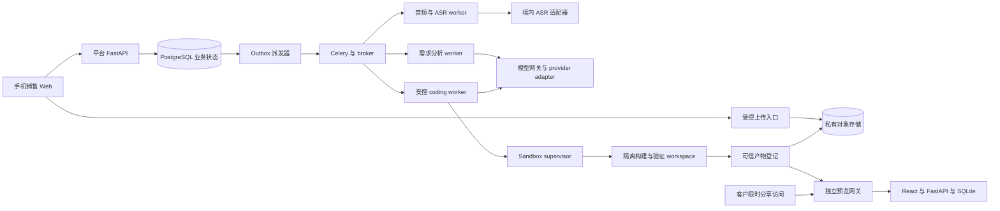
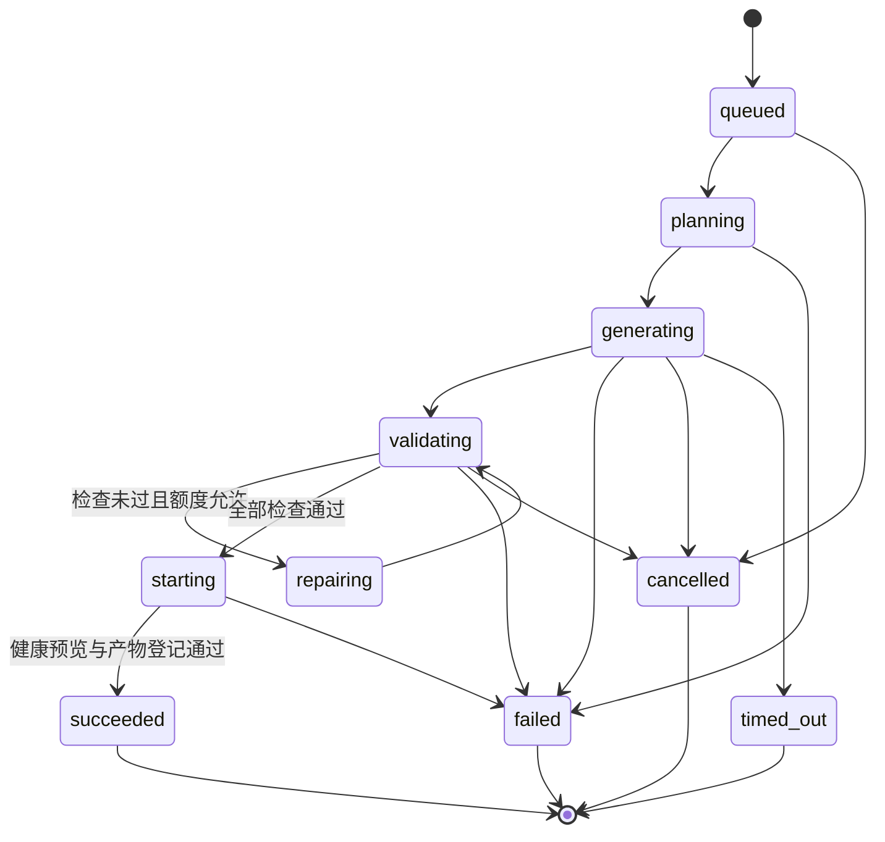
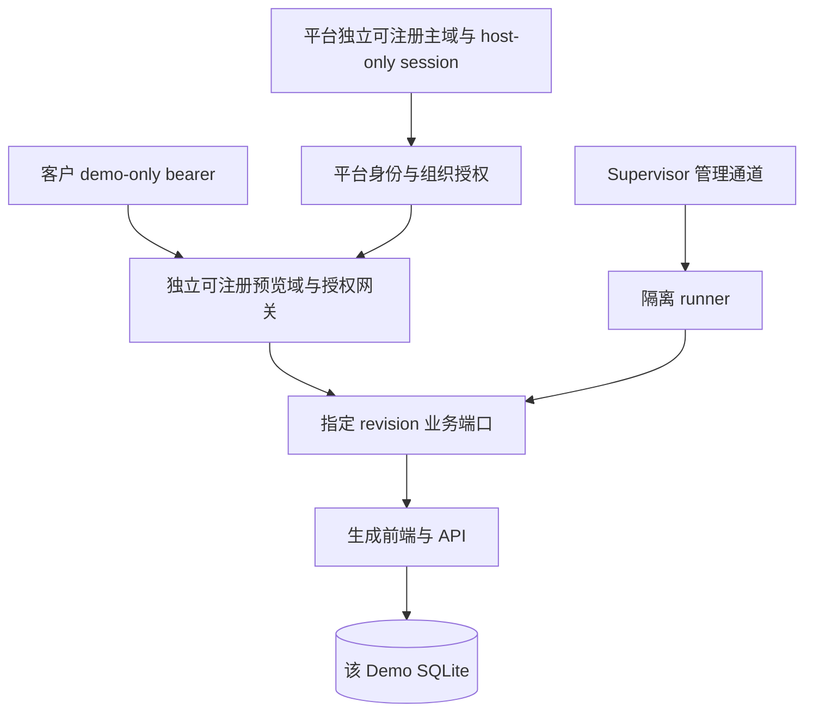

# 技术架构：证据、生成任务与独立预览

状态：**方案草案**。日期：2026-10-12，Asia/Shanghai。文档描述拟议系统，没有任何集成、准确率、运行隔离或验收已通过的含义。

## 1. 架构目标与系统边界

业务主链路必须可以追溯：来源版本 → 需求版本/hash → 模板版本 → generation_job/attempt → demo_revision → 验证报告/产物 hash → 分享授权。
平台负责事实、归属、确认、状态和访问；Agent 只负责独立 workspace 内有限代码变更；preview runtime 只处理合成业务数据。
手机端负责采集、确认、进度和访问演示，耗时分析、生成、检查与启动由服务器执行。手机 PWA 安装不改变录音前后台保证。

图中的调用不代表 Agent 能直接连接平台数据库或存储后台。业务服务向 worker 发出短期、任务限定的取件授权；模型凭证由网关持有，sandbox 不持有平台管理员凭证。

## 2. 推荐技术栈与两种替代

| 层次 | 推荐候选 | 理由及待验证范围 |
|---|---|---|
| 平台移动前端 | React + TypeScript + Vite + Ant Design Mobile | 四入口 SPA、表单与任务卡片；录音、滚动、触摸与浏览器版本需实测。 |
| 平台后端 | FastAPI + Pydantic | Python 模型/ASR/worker 协作及结构校验；授权和幂等由应用实现。 |
| 平台数据 | PostgreSQL | 租户、项目、证据、版本、任务、outbox、租约、审计的事实来源。 |
| 大对象 | 私有 S3 兼容存储 | 音频、原始 ASR 结果、源码、检查报告及 SQLite 快照；具体服务须测试签名和生命周期。 |
| 作业投递 | Celery + Redis 协议 broker | 分发与有限重试；自托管候选 Valkey，具体版本兼容和持久性须 PoC。 |
| 需求模型 | 百炼/Qwen 或 DeepSeek adapter | 按模型/API/模式声明结构化与工具能力，不固定未测试最新型号。 |
| coding 引擎 | OpenAI Agents SDK，显式 Chat Completions 模型适配 | 首轮 PoC；自定义受限工具，关闭默认 OpenAI tracing 出口。 |
| coding 备选 | OpenHands Software Agent SDK | 需要更成熟代码编辑/会话恢复时评估，不 fork 整套 Canvas。 |
| 生成物 | React + TypeScript + Vite、FastAPI、独立 SQLite | 固定模板、真实 HTTP CRUD、快照和重建；生产交付另立方案。 |
| runtime | 独立 Linux runner；强隔离 PoC 后外部分享 | 内部有限试点可评估加固 Docker，gVisor/微 VM/托管沙箱是扩展候选。 |

替代 A 是 Vue + TypeScript + Vite 搭配 FastAPI，适合团队 Vue 经验明显更强；保留数据和任务契约，只替换平台前端，避免在一个 MVP 混用两套 UI 技术。
替代 B 是 React/Next.js + NestJS 的 Node 平台，适合已有统一 TypeScript 服务团队；ASR、模型及沙箱 worker 可独立服务。SSR/BFF 带来的部署和状态复杂度应有实际需求支持。
三者不会改变手机不执行生成后端、平台库与 Demo 库分离、需求人审和外部分享隔离门槛。推荐是团队能力未明确时的草案基线。

## 3. 组件职责与持久事实

| 组件 | 负责 | 禁止承担/信任的内容 |
|---|---|---|
| 平台 API | 登录、归属校验、CRUD、确认、配额、分享、逻辑删除。 | 不同步等待整个生成，不执行生成代码。 |
| PostgreSQL | 业务对象、状态转换、idempotency、outbox、lease、fencing token。 | broker ACK 或模型文字不能代替可信检查证据。 |
| 音频 worker | 顺序合并、解码、转码、时长核验、ASR submit/query/result。 | 不把分片直接当独立音频或通用实时 ASR 帧。 |
| 分析 worker | 来源固定、模型输出解析、证据校验、生成 draft。 | 无 terminal、发布或任意网络浏览工具。 |
| coding worker | 计划、模板范围 patch、固定检查、最多 2 轮修复。 | 不改冻结需求、锁文件、网关、策略和验收程序。 |
| Supervisor | 资源/网络/文件隔离，固定命令，进程取消及清理。 | 不由 Agent 控制 Docker daemon 或沙箱管理 API。 |
| 产物服务 | 验证摘要、源码/hash/lock、快照登记和脱敏导出。 | 不接受 Agent 自报的成功状态。 |
| 预览网关 | 验证访问、固定端口路由、过期/撤销、健康与唤醒。 | 不公开 terminal、文件管理、数据库控制台。 |

队列消息只包含业务 task/job ID、版本与 trace_id，不携带完整客户访谈或密钥。PG 内同一事务写业务状态和 outbox，派发器投递并确认；补投以数据库记录为依据。
Celery 只提供投递/重试能力；官方明确 broker 不是数据库，重投语义需要幂等处理，不存在本方案已实现的端到端 exactly-once 保证。([Celery tasks](https://docs.celeryq.dev/en/stable/userguide/tasks.html)，[Redis broker](https://docs.celeryq.dev/en/stable/getting-started/backends-and-brokers/redis.html))

## 4. 音频契约与完整性

前台页面在 HTTPS 下调用 getUserMedia + MediaRecorder，探测 MIME 并记录实例实际 mimeType/codec；浏览器约束的请求值不能当作实际采样率和声道数。([MDN](https://developer.mozilla.org/en-US/docs/Web/API/MediaDevices/getUserMedia)，[MIME 探测](https://developer.mozilla.org/en-US/docs/Web/API/MediaRecorder/isTypeSupported_static))
每个新 MediaRecorder 对应 recording_stream_id；分片包含 seq（从 0）、hash、字节数、MIME、客户端事件时间、服务器 ACK 状态。客户端以独立计时器记录经过时间，不能用分片数乘以 5 秒推算时长。
timeslice 目标 5 秒，实际会被锁屏、Safari 暂停或主线程阻塞影响。每个 Blob 不必独立可解码，只有完整流有可播放要求。([MDN dataavailable](https://developer.mozilla.org/en-US/docs/Web/API/MediaRecorder/dataavailable_event)，[W3C](https://www.w3.org/TR/mediastream-recording/))

上传采取 at-least-once 重试，服务端以 stream_id + seq 约束唯一性；同 hash 返回已有 ACK，不同 hash 返回冲突，不覆盖原件。
服务端 ACK 必须表示对象持久写入及记录登记完成；完成前客户端只保留 pending 状态。IndexedDB 是有界 best-effort 缓冲，不是数据无损保证。([存储规则](https://developer.mozilla.org/en-US/docs/Web/API/Storage_API/Storage_quotas_and_eviction_criteria))
停止必须等待最终 dataavailable、stop 及全部上传 ACK，然后发 finalize manifest。后台逐流按 seq 拼接原始字节，检查缺片/hash，解码后按会话顺序组合统一音频，并记录暂停/缺失/裁切的时间映射。
不同 stream 不直接二进制拼接；每条流单独解码。不可解码原件保留供重传诊断；部分可恢复时必须经销售接受 incomplete 标记，不能等同完整音频。
ASR 只接收校验完成的标准音频或供应商支持的容器。源文件保留原编码，转码规格按具体 ASR engine 配置，不提前假定所有模型接收 16 kHz WAV。

默认录音上限 30 分钟、源上传总量 100 MiB 是试点政策，转码副本另设容量预算。API 分片请求上限与大 Blob 拆分策略须由 P0 记录确定，不能因目标 5 秒拒绝合法延迟片。
能力降级为文件上传/文本粘贴。无背景录音、系统通话录音承诺；微信、来电、锁屏、音频路由与 kill 恢复独立测验。

## 5. ASR 与证据处理

默认候选为境内录后云 ASR；阿里首轮主候选，腾讯/火山使用同语料对照，采购结果及账号地域仍待确认。FunASR/faster-whisper 为私有化替代，代码与 checkpoint 权重许可证分别登记。
ASR adapter 输入标准音频引用、语言、热词、匿名 speaker 参数、deadline；输出 transcript_version、segments、start_ms/end_ms、speaker_id、原始结果引用、engine/model、provider_task_id 和 usage。
供应商 task_id 不是平台主键；供应商结果有短期有效窗口，完成后立即保存受控原件与标准化结果。说话人分离只表示匿名聚类，不等于姓名/客户角色/决策人识别。([阿里文件 API](https://help.aliyun.com/zh/model-studio/fun-asr-recorded-speech-recognition-http-api)，[腾讯 API](https://cloud.tencent.com/document/product/1093/37823))
人工修订新增 transcript_version，保留原版、修订人、时间及差异；同会话角色映射也版本化。需求引用稳定 segment ID + transcript_version，并保存必要摘录。
原音到期后 audio_available=false，文字证据仍可显示；转写全文到期后，已确认需求仅保留必要引用摘录及来源版本，不再伪造完整来源可访问。

## 6. 结构化需求与 provider adapter

需求对象包括目标、痛点、角色、实体/字段/关系、主流程、功能优先级、限制、集成、验收、开放问题和来源。
每条项分别记录 source_kind（customer_quote / sales_note / ai_suggestion / customer_feedback）、epistemic_status（fact / inference / unknown）和 confirmation（pending / accepted / edited / rejected）；销售明确补充是销售来源的 fact，不能冒充客户事实。预算、姓名、联系人、权限和外部集成不能因字段必填而编造。
需求分析固定输入来源版本，并验证引用真实存在、时间区间合法、原话一致、实体/角色关系、状态流转和所选范围。critical ambiguity 只针对本次 Demo 核心行为；外部集成未知可明确排除。
确认采用乐观并发校验，服务器生成规范化快照及 hash，记录登录身份；confirmed 不可变，新确认版使旧版 superseded。job 永远保存提交时需求版本和 hash。

| adapter 契约 | 设计要求 |
|---|---|
| 输入 | purpose、provider/model/region/API/mode、分离的指令与数据、Schema、工具白名单、token/调用预算、deadline、取消信号。 |
| 能力 | json_object、strict_json_schema、tool_call、strict_tool_arguments、streaming、usage_reporting、Schema 子集、上下文范围。 |
| 输出 | parsed_data、原始响应引用、finish_reason、refusal/incomplete、tool call ID、token usage、provider_request_id、耗时。 |
| 错误 | 地域/鉴权、限流、超时、上下文超限、Schema 不支持、拒绝、截断、预算不足、取消，分类记录。 |

验证支持 native strict schema 时采用；不支持时走普通 JSON/文本解析 + Pydantic 结构/语义校验 + 有界纠正。格式约束不证明事实正确。DeepSeek JSON mode 与 strict beta、Qwen 型号及模式差异必须各自测验。([Qwen](https://www.alibabacloud.com/help/en/model-studio/qwen-structured-output)，[DeepSeek JSON](https://api-docs.deepseek.com/guides/json_mode)，[工具调用](https://api-docs.deepseek.com/guides/tool_calls))
OpenAI-compatible endpoint 不能证明 Responses、strict Schema、工具结果、取消或 usage 完全兼容；模型网关保存能力测试版本，未通过能力不启用。
主备切换仅允许尚未执行外部副作用的阶段，记录切换原因；不能盲重放已完成工具/厂商提交，不保证绝不重复模型计费。
job 冻结可用 provider/model 策略，attempt 记录实际 provider、model、API、mode 和 capability_version；人工 retry 仅能在该冻结允许策略内切换，不能扩大工具/预算/时限。新增提供方或超出原策略需新 job。

## 7. 有界 coding worker

首轮 PoC 使用 OpenAI Agents SDK 的显式 OpenAIChatCompletionsModel 对接百炼/DeepSeek。SDK 是 MIT 的编排库，不要求 OpenAI 模型服务。关闭默认 tracing export，使用境内最小化元数据或自定义审计。([Models](https://openai.github.io/openai-agents-python/models/)，[Tracing](https://openai.github.io/openai-agents-python/tracing/))
只提供平台自定义工具：列允许文件、读允许文件、应用受限 patch、运行固定检查并取安全摘要；通用宿主 terminal、任意 URL、依赖安装、生产发布不在工具集中。
工具调用由服务端策略校验路径、符号链接、文件类型、大小、变更行数及禁止文件；Agent 输入是冻结业务 spec、模板摘要和少量必要去标识摘录，不是完整录音库。
SDK 的 sessions、RunState 或 OpenHands persistence 不能代替 job 数据库和 workspace 快照；若恢复复杂度成为障碍，可切换 OpenHands SDK adapter。首期不引入 LangGraph 顶层编排或多 Agent 相互改文件。

流程：读取不可变需求/模板 → 生成可检验修改计划 → policy 校验范围 → patch → 固定构建/业务检查 → 最多 2 轮自动修复 → 封装产物 → 启动健康预览。
所有模型/工具调用受 token、调用次数、文件/输出大小、CPU/内存/磁盘与每 attempt 15 分钟活动执行 deadline 约束；从首次 lease acquisition 起计时，不含排队，恢复不重置截止，人工 retry 新 attempt 仍受 job/租户累计预算。确切 token 与工具上限由模型样本 PoC 校准并登记，不能无限循环。
模型不得修改检查器、跳过测试、删除授权、换镜像源或改模板锁文件来“修复”。失败输出显示可读摘要和证据引用，不泄露思维链、完整工具日志或机密。

## 8. job、attempt 与运行状态

图省略其他活动阶段到失败/超时/取消的同类边；完整规则见[数据与 API](data-and-api.md)。cancel_requested 是独立时间标志，活动阶段可先继续显示，停止确认后才转 cancelled。
一个 generation_job 是冻结输入/模板/策略的一次用户请求；一个 attempt 是一次执行。自动修复在本 attempt 内计 repair_round；人工重试创建新 attempt 并重新 queued，旧 attempt 及失败原因不可被覆盖。
每个 job 最多一个 active attempt，同一 demo_revision 最多一个 published artifact。想更改需求、模板版本或范围必须新 job/revision。
runtime 状态为 provisioning / running / sleeping / waking / expired / failed / deleted，与生成历史分离；runtime 故障或到期不重写 job succeeded。

## 9. 租约、崩溃、重复投递与取消

worker 取消息先原子检查终态、预算及 active attempt，争取带截止时间的 lease 与单调 fencing token；周期 heartbeat 延长租约并写可信阶段证据。
状态/产物发布必须带当前 fencing token；租约失效的旧 worker 即使复活，也不能再提交产物。supervisor 用 attempt 标识幂等创建环境，重复投递不无条件开第二份。
租约到期先查询 supervisor、provider 请求和检查证据，确认旧执行停止后恢复可信阶段或将 attempt 标记 failed；随后系统恢复或人工 retry 建立新 attempt。不能仅凭 broker 消息再次出现就重复外部调用。
模型调用发出但返回未落库时，费用及响应可能未知；保存 provider_request_id、调用意图和结果，明确不可消除重复计费边界。
visibility timeout、late ACK、worker-lost、prefetch、任务最长时限需同版本故障实验。Valkey 虽是 BSD-3-Clause，Celery Redis transport 对具体版本的兼容仍是待验证假设。([Valkey](https://github.com/valkey-io/valkey/blob/unstable/COPYING)，[Celery](https://docs.celeryq.dev/en/stable/getting-started/backends-and-brokers/redis.html))
取消先写标志并撤销后续工具许可，协作式停止模型/任务；超出清理期限则 supervisor 终止进程、容器、短期凭证。只有清理证据确认才写 cancelled；Celery revoke 本身不是清理完成证明。
长时间人工需求确认不占 worker。ASR/需求分析使用独立 analysis task，失败/重试不改生成任务的版本事实。

## 10. Demo 的真实运行与质量 gate

平台 PostgreSQL 保存客户/证据/授权；每个 preview workspace 的 SQLite 只保存合成业务数据，禁止连接平台业务库。
MVP 同一 demo_revision 的销售与分享访客共用一组合成数据，预览显式告知共享写入；owner reset 有审计及丢弃提示。每分享独立 DB 副本后续再评估，避免首期隐含此隔离承诺。
每模板固定 React/TypeScript/Vite 与 FastAPI 依赖及锁文件，固定基础镜像 digest，生成时从审核缓存取依赖。API 与前端同 Demo origin，网关只映射已登记业务端口。

| 必过检查 | 可审阅证据 |
|---|---|
| 供应链与结构 | 模板版本/hash、依赖锁/hash、允许 patch、secret/真实数据检查。 |
| 前端与后端 | 类型检查、production build、后端启动及 health、API 契约摘要。 |
| 实际 CRUD | list → create → get → update → delete → 再读不存在；非法输入/未知 ID 错误正确。 |
| 数据持久化 | 写入后重复读取一致、服务重启仍存在、SQLite 快照恢复及 reset seed。 |
| 业务状态 | 主流程与角色约束、非法跳转拒绝、演示模拟项明确标注。 |
| 手机 smoke | 手机 viewport 完成创建/编辑/刷新、关键 console/network 错误检查。 |
| 预览启动 | 独立 origin、网关授权、健康检查、快照/产物匹配。 |

只在全部 gate 通过后 succeeded；检查由可信固定程序执行，Agent 不能更改。自动修复最多 2 次，不包含人工 retry；每次调用计入费用。
归档源码 bundle、模板/锁/hash、patch、验证报告与一致性 SQLite 快照到对象存储。runtime/sandbox vendor snapshot 仅作加速，不能是唯一可恢复副本。
休眠关闭运行资源，唤醒从登记产物及快照重建，再做 health；SQLite 快照需在一致性窗口或备份机制下生成，不复制正在写入的不一致文件。
导出仅含源码、锁、合成 seed/数据结构、启动说明、验证摘要和许可清单，不含平台 token、模型 key、真实音频及沙箱管理凭证。

## 11. 隔离、供应链和外部分享

内部受限模板试点可评估独立 Linux 主机加固 Docker：非 root、drop capabilities、no-new-privileges、限制 CPU/内存/PID/磁盘、只读根、仅独立工作卷、无 docker.sock/host network/宿主目录挂载。
普通共享主机 Docker 不是任意不可信代码的充分安全边界，官方也说明默认 capability、挂载和内核攻击面的限制。外部分享或执行不受控 patch 前，必须通过独立 runner + gVisor/微 VM/适当托管 sandbox PoC。([Docker](https://docs.docker.com/engine/security/)，[gVisor](https://gvisor.dev/docs/))
gVisor 是用户态 application kernel，不等同微 VM；兼容性与 syscall 开销需在 Python/SQLite/Node/检查器上实测。E2B/Daytona 可选，国内网络、数据驻留、阶层限制和实际费用不预设。
构建网络仅开放审核 registry/内部制品源，运行时默认禁止出网；同时阻断云 metadata、内网、其他 sandbox、DNS/IPv6 绕过。规则由 supervisor/网络层执行，提示词不是权限边界。
模型和 Agent 长期密钥由平台网关持有。沙箱仅获得当前合成输入和产物写入通道，无法取得主平台 DB、对象存储 admin 或云控制凭证。
访谈中的“忽略规则/运行命令”只作为业务数据，不升级为指令；输出 patch、HTML、依赖安装脚本及工具日志均是不可信内容。([OWASP](https://cheatsheetseries.owasp.org/cheatsheets/LLM_Prompt_Injection_Prevention_Cheat_Sheet.html))

平台和预览使用不同可注册主域，host-only cookies，不设共享 Domain cookie。分享凭证换取仅该预览域的短期访问 cookie，限制 demo/revision、业务端口、有效期；日志对 URL token 脱敏。
客户 bearer 与已登录销售授权是两个 audience，禁止 token 交换为平台 session。普通沙箱 admin/preview token 不发给客户；Daytona 文档明确普通 token 权限较宽，应使用受限单端口签名或自建网关。([Daytona preview](https://www.daytona.io/docs/en/preview/))
配置 CSP、CORS、frame-ancestors、Referrer-Policy；独立页面为默认，iframe 仅作为辅助并验证 sandbox/postMessage origin。分享撤销立刻在网关失效，runtime 唤醒不得重置有效期。

## 12. 运行、保留、成本与观测

| 试点政策建议 | 初始值 | 校准依据 |
|---|---|---|
| 原音/转码/分片 | 30 天 | 授权与回听目的。 |
| 转写全文 | 180 天 | 售前跟进目的；已确认证据摘录按项目保留。 |
| 源码与 SQLite 快照 | 30 天 | 演示周期、存储预算；到期停止可恢复能力。 |
| 私密分享 | 建议 7 天，实际不超过政策/请求时长/产物剩余寿命，可随时撤销 | 客户会议周期。 |
| runtime 无访问休眠 | 30 分钟 | 唤醒成本和保存一致性。 |
| attempt 活动执行 walltime / 自动修复 | 15 分钟（不含排队，恢复不重置）/ 2 轮 | 模型/模板样本成本与失败分布。 |
| 用户/租户生成并发 | 1 / 2 | 容量、预算与公平性。 |
| 单 sandbox 起始资源 | 2 vCPU / 2 GiB | 必须容量验证，不能当作已足够。 |

项目及 confirmed spec 按组织政策保留至项目删除；必要证据摘录与全文/原音分开保留。备份建议滚动 30 天且隔离，删除先立即逻辑撤销，再异步物理清理；备份恢复前重放删除清单，窗口结束移除备份副本。
保留计时建议：原音从会话音频确认保存起，转写全文从各版本持久化起，成功 revision 的源码/快照从产物登记起；后续休眠快照不自动续期。失败 attempt 的诊断产物从结束起按同 30 天上限清理，实际政策由组织评审。
供应商结果到期不证明供应商源音已删除；需另核合同、训练用途、地域和删除能力，客户告知/授权由业务负责人确定。([个人信息保护法](https://www.cac.gov.cn/2021-08/20/c_1631050028355286.htm))

单位任务成本建议按实际计量累加：C = ASR 计费分钟 × 当前价 + Σ(输入 token × 输入价 + 输出 token × 输出价) + sandbox 活动分钟 × 对应资源价 + 存储 GB·月 × 存储价 + 出站 GB × 流量价。
Σ 包含草稿纠正、自动修复、手动 retry 和已计费失败；cached token 按实际供应商规则单列。unknown usage 记录为未知，不填零；自行部署还需服务器闲置、GPU、运维和备份成本。
不写虚构单价或 P95 保证。设置租户月预算预警/硬上限、job 预算、按 purpose 的模型消费；已调用后计费可能超预估，留安全余量并记录。
观测包含 trace_id、业务 task_id、job/attempt、spec/template/policy/model 版本、阶段耗时、failure_code、usage、lease/heartbeat 和预览健康；业务全文默认不写普通日志。
告警覆盖 outbox 积压、租约失效、重复发布冲突、ASR 结果拉取失败、snapshot 失败、预算异常、删除积压和运行资源残留；运维查看内容需明确授权。

## 13. 实施前验证与演进条件

先验证浏览器录音完整性、同语料 ASR、模型 provider 能力、三个模板真实 CRUD、Valkey/Celery 重投与强隔离；没有证据时不开放外部分享。
若多分支人工暂停/回溯成为核心需求，再评估 LangGraph 仅编排 AI 子流程，平台 PG 仍掌握最终业务状态。若自由度需求超过模板覆盖，再评估新增模板或更强 coding SDK，避免提前接入整套 builder。
从售前 Demo 升级生产系统需独立评审：数据库迁移、账号与业务权限、备份/SLA、安全测试、真实集成及运维责任，不能把本方案的 succeeded 当作生产交付许可。
决策依据见[调研报告](<AI%20%E9%94%80%E5%94%AE%E5%8A%A9%E6%89%8B%20%E6%8A%80%E6%9C%AF%20%E8%B0%83%E7%A0%94.md>)，契约见[数据与 API](data-and-api.md)，验证活动见[阶段计划](../../03-%E6%B5%8B%E8%AF%95%E4%B8%8E%E4%BA%A4%E4%BB%98/%E6%B5%8B%E8%AF%95%E9%AA%8C%E6%94%B6/phase-plan-and-acceptance.md)。
